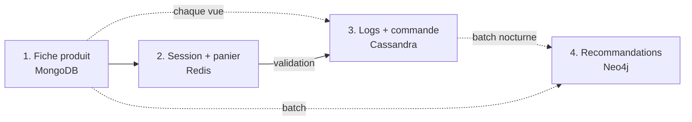

# NoSQL CODA - LDLC

**Refonte LDLC — Architecture de données NoSQL**

**Binôme :** Zakaria SOUAL, Issam BELHORMA

Projet NoSQL : concevoir l'architecture de données de la nouvelle plateforme e-commerce de LDLC
(27 000 références, millions de visites par mois, jusqu'à 25 000 colis par jour).

## Architecture

Pas de base unique : **persistance polyglotte**, une base choisie pour chaque besoin.

| Lot | Besoin | Base | Famille | CAP |
|---|---|---|---|---|
| 1 | Catalogue produits (schémas variables, lu très souvent) | **MongoDB** | Document | CP |
| 2 | Panier et sessions (latence < 1 ms, expiration) | **Redis** | Clé-valeur | AP |
| 3 | Logs et analytics (millions d'écritures par jour) | **Cassandra** | Colonnes | AP |
| 4 | Recommandations (parcours de relations) | **Neo4j** | Graphe | CP |

Schéma complet et flux de données : [`docs/architecture.md`](docs/architecture.md)

## Sommaire des livrables

| Livrable | Emplacement |
|---|---|
| Schéma d'architecture globale | [`docs/architecture.md`](docs/architecture.md) |
| Lot 1 — Catalogue (MongoDB) | [`lot1-catalogue-mongodb/schema_catalogue.md`](lot1-catalogue-mongodb/schema_catalogue.md) |
| Lot 2 — Panier et sessions (Redis) | [`lot2-panier-redis/schema_panier.md`](lot2-panier-redis/schema_panier.md) |
| Lot 3 — Logs et analytics (Cassandra) | [`lot3-logs-cassandra/schema_logs.md`](lot3-logs-cassandra/schema_logs.md) |
| Lot 4 — Recommandations (Neo4j) | [`lot4-reco-neo4j/schema_reco.md`](lot4-reco-neo4j/schema_reco.md) |
| Environnement (4 bases) | [`docker-compose.yml`](docker-compose.yml) |

Chaque document de lot contient : choix technologique, schéma, justification des compromis et
requêtes types. Chaque lot a un script `requetes.py` qui exécute ces requêtes.

## Lancer le projet

### 0. Prérequis

- **Docker** et **Docker Compose** (Docker Desktop sur Mac / Windows)
- **Python 3.10+**
- Ports libres : `27017` (MongoDB), `6379` (Redis), `9042` (Cassandra), `7474` et `7687` (Neo4j)
- Environ 3 Go de RAM disponibles pour les 4 conteneurs

### 1. Récupérer le dépôt

```bash
git clone https://github.com/IssamBELHORMA/NoSQL_CODA.git
cd NoSQL_CODA
```

### 2. Démarrer les 4 bases

```bash
docker compose up -d
docker compose ps        # les 4 conteneurs ldlc-* doivent être "Up"
```

Cassandra met **environ 1 minute** à démarrer. Avant le Lot 3, vérifier qu'elle répond :

```bash
docker exec ldlc-cassandra cqlsh -e "DESCRIBE KEYSPACES"
```

### 3. Installer les dépendances Python

```bash
python -m venv venv
source venv/bin/activate          # Windows : venv\Scripts\activate
pip install -r requirements.txt
```

Toutes les commandes suivantes se lancent **depuis la racine du dépôt**, avec le venv activé.

### 4. Lot 1 — Catalogue (MongoDB)

```bash
python lot1-catalogue-mongodb/import_raw.py   # JSON bruts -> collections raw_* (51 837 documents)
python lot1-catalogue-mongodb/data.py         # produits, marques, avis, index (11 012 produits)
python lot1-catalogue-mongodb/requetes.py     # requêtes types R1 à R11
```

### 5. Lot 2 — Sessions et panier (Redis)

```bash
python lot2-panier-redis/client_redis.py      # test de connexion et mesure de latence
python lot2-panier-redis/sessions.py          # session partagée entre serveurs, TTL glissant
python lot2-panier-redis/panier.py            # panier, fusion à la connexion, prix lus dans MongoDB
```

`sessions.py` et `panier.py` attendent quelques secondes pour montrer l'expiration automatique.

### 6. Lot 3 — Logs et analytics (Cassandra)

```bash
python lot3-logs-cassandra/client_cassandra.py   # crée le keyspace ldlc_logs et les 4 tables
python lot3-logs-cassandra/generer_logs.py       # 50 000 événements sur 7 jours (~20 s)
python lot3-logs-cassandra/commandes.py          # 3 000 commandes de test + historique de U1024
python lot3-logs-cassandra/requetes.py           # top semaine, vues du jour, recherches, historique
```

Le Lot 1 doit avoir été lancé avant : les événements et commandes utilisent les SKU du catalogue.

### 7. Lot 4 — Recommandations (Neo4j)

```bash
python lot4-reco-neo4j/import_graphe.py     # produits, marques, catégories depuis MongoDB
python lot4-reco-neo4j/compatibilites.py    # sockets et formats (processeur, carte mère, boîtier)
python lot4-reco-neo4j/achats.py            # clients et achats croisés depuis Cassandra
python lot4-reco-neo4j/requetes.py          # requêtes de recommandation R1 à R6
```

Les lots 1 et 3 doivent avoir été lancés avant. Le graphe est consultable dans le navigateur :
<http://localhost:7474> (utilisateur `neo4j`, mot de passe `password123`), par exemple avec
`MATCH (p:Produit {nom: 'AMD Ryzen 7 7800X3D'})-[r]-(x) RETURN p, r, x LIMIT 50`.

### 8. Consulter les bases directement (optionnel)

```bash
docker exec -it ldlc-mongo mongosh ldlc                 # MongoDB
docker exec -it ldlc-redis redis-cli                    # Redis
docker exec -it ldlc-cassandra cqlsh -k ldlc_logs       # Cassandra
```

### 9. Arrêter / repartir de zéro

```bash
docker compose down        # arrête les conteneurs (les données sont conservées)
docker compose down -v     # arrête et supprime aussi les données
```

Les scripts des lots 1 et 4 repartent de zéro à chaque lancement. Ceux du Lot 3 **ajoutent**
des données (les compteurs de vues s'additionnent) : pour un état propre, supprimer le keyspace
(`docker exec ldlc-cassandra cqlsh -e "DROP KEYSPACE ldlc_logs"`) puis relancer l'étape 6.

### Ordre des dépendances

```
Lot 1 (MongoDB) ──> Lot 2 (prix du panier)
       │
       ├──────────> Lot 3 (SKU des événements et des commandes)
       │                    │
       └──────────> Lot 4 <─┘ (produits depuis MongoDB, achats depuis Cassandra)
```

## Exemple : le chemin de la donnée

Alice (client `U1024`) achète un processeur AMD Ryzen 7 7800X3D.



### 1. Produit — MongoDB (Lot 1)

Alice ouvre la fiche produit : **une seule lecture** par le slug, sans jointure.

```python
db.produits.find_one({"slug": "amd-ryzen-7-7800x3d-f7926ae16e"})
```
```json
{
  "sku": "CPU-F7926AE16E", "nom": "AMD Ryzen 7 7800X3D", "prix": 312.85, "stock": 29,
  "categorie": { "nom": "Processeurs", "chemin": ["Composants", "Processeurs"] },
  "marque": { "_id": "M_AMD", "nom": "AMD" },
  "specs": [ { "k": "core_count", "v": 8 }, { "k": "microarchitecture", "v": "Zen 4" } ]
}
```

### 2. Client — Redis (Lot 2)

Sa session est partagée par tous les serveurs web, et son panier expire après 24 h d'inactivité.

```
HSET   session:3f2a…  user_id U1024  nom Alice  derniere_page /produit/amd-ryzen-7-7800x3d
EXPIRE session:3f2a…  1800            # 30 min, remis à zéro à chaque requête

HINCRBY panier:U1024  CPU-F7926AE16E 1
HINCRBY panier:U1024  MB-F7926AE6F2  1   # Asus PRIME B650-PLUS WIFI
EXPIRE  panier:U1024  86400
```

Les prix ne sont pas stockés dans Redis : ils sont relus dans MongoDB à l'affichage du panier.

### 3. Analytics — Cassandra (Lot 3)

Chaque vue de la fiche est écrite dans le journal et incrémente deux compteurs :

```sql
INSERT INTO evenements_par_jour (jour, bucket, ts, type, user_id, sku) VALUES ('2026-11-18', 3, now(), 'vue', 'U1024', 'CPU-F7926AE16E');
UPDATE vues_par_produit SET vues = vues + 1 WHERE sku = 'CPU-F7926AE16E' AND jour = '2026-11-18';
UPDATE vues_par_jour    SET vues = vues + 1 WHERE jour = '2026-11-18' AND sku = 'CPU-F7926AE16E';
```

À la validation, le panier Redis devient une commande (écrite en `LOCAL_QUORUM`), puis il est supprimé :

```sql
SELECT date_commande, total, lignes FROM commandes_par_client WHERE user_id = 'U1024';
--  2026-11-18 | 460.04 | {'CPU-F7926AE16E': 1, 'MB-F7926AE6F2': 1}
```

Le marketing peut alors demander : vues du produit aujourd'hui, top 10 de la semaine, top des recherches.

### 4. Recommandation — Neo4j (Lot 4)

Chaque nuit, les commandes Cassandra mettent à jour le graphe (`A_ACHETE`, `ACHETE_AVEC`).
Sur la fiche du 7800X3D, le site propose :

```cypher
// Cartes mères compatibles (même socket) ET souvent achetées avec ce processeur
MATCH (cpu:Produit {sku: 'CPU-F7926AE16E'})-[:SOCKET]->(s:Socket)<-[:SOCKET]-(mb:Produit),
      (cpu)-[r:ACHETE_AVEC]-(mb)
RETURN mb.nom, s.nom, r.nb ORDER BY r.nb DESC LIMIT 5
```

Et sur sa page d'accueil, Alice voit les produits achetés avec ce qu'elle a déjà acheté
(alimentation, mémoire DDR5, boîtier...), sans ceux qu'elle possède déjà.

## Structure du dépôt

```
├── docker-compose.yml        MongoDB, Redis, Cassandra, Neo4j
├── requirements.txt
├── docs/architecture.md      schéma d'architecture globale
├── lot1-catalogue-mongodb/   import, modèle, index, requêtes R1-R11
├── lot2-panier-redis/        sessions, panier, persistance AOF
├── lot3-logs-cassandra/      schema.cql, générateur de logs, commandes, requêtes
└── lot4-reco-neo4j/          import du graphe, compatibilités, achats croisés, requêtes
```
