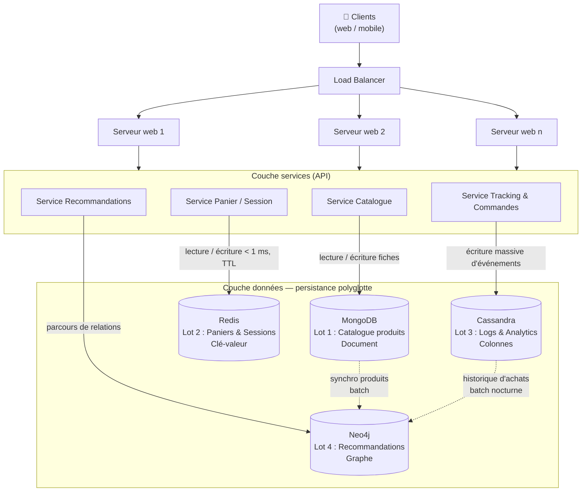

# Architecture globale — Refonte LDLC

## Schéma

## Rôle de chaque base

| Lot | Base | Famille | Pourquoi | Priorité CAP |
|---|---|---|---|---|
| 1. Catalogue | MongoDB | Document | Schémas variables par catégorie, sous-documents (specs, avis), lectures fréquentes | CP (replica set : lectures cohérentes sur le primaire) |
| 2. Panier & Sessions | Redis | Clé-valeur | Latence sub-milliseconde, TTL natif, sessions partagées entre serveurs web | AP (perte d'un panier tolérable, disponibilité prioritaire) |
| 3. Logs & Analytics | Cassandra | Colonnes | Millions d'écritures/jour, données temporelles, rétention longue | AP (cohérence à terme acceptable pour des logs) |
| 4. Recommandations | Neo4j | Graphe | Parcours de relations (achats croisés, compatibilités) | CP |

## Flux de données
- **Temps réel** : chaque service lit et écrit directement dans sa base (traits pleins).
- **Batch** (pointillés) : Neo4j est alimenté périodiquement à partir des produits (MongoDB) et de l'historique d'achats (Cassandra), pour calculer les relations « achetés ensemble ». Les recommandations n'ont pas besoin d'être à jour à la seconde près.
- **Sessions partagées** : les serveurs web sont *stateless*. La session est stockée dans Redis, donc n'importe quel serveur peut traiter la requête suivante d'un client.